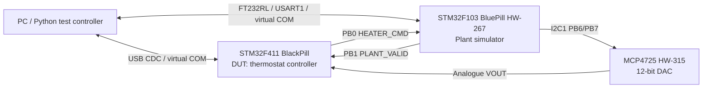
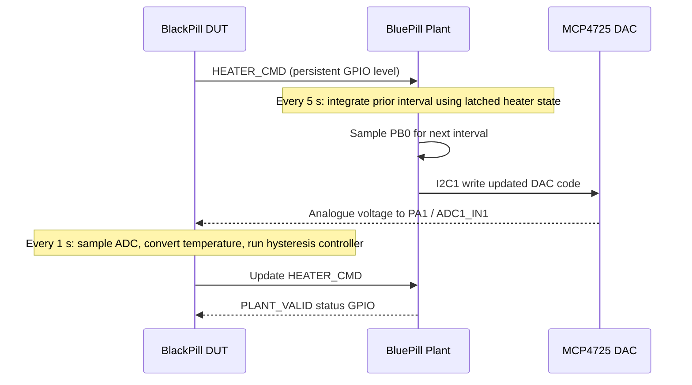
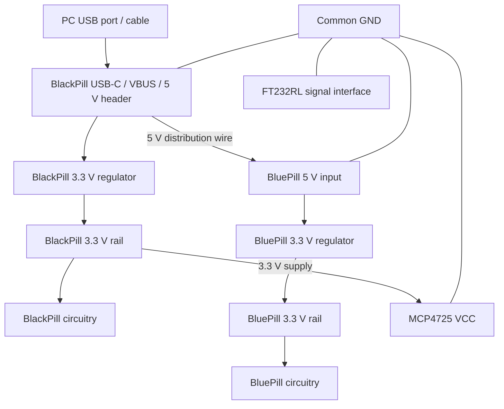

# HIL Architecture and Wiring Diagrams

> **Design baseline:** 2026-11-10
> **Use with:** [Protocol V1.0](HIL_PROTOCOL_V1.0.md) and [milestone status](MILESTONE_STATUS.md).
> **Scope:** Current two-MCU low-voltage HIL prototype. GPIO marker pins used only for diagnostics are not part of the final HIL wiring.

## 1. Functional architecture



The PC supervises, configures, starts/stops and records the experiment. It is not in the embedded feedback loop.

## 2. Closed-loop operation



The plant task integrates the just-completed interval using the heater state latched for that interval, then samples the current GPIO level for the next interval. This preserves causality with independent 1 s and 5 s schedules.

## 3. Power distribution



**Power rules:**

1. BlackPill is powered through its USB-C connector.
2. BlackPill `5V` header distributes 5 V to BluePill `5V` input.
3. BluePill micro-USB power connector remains unplugged while shared 5 V is connected.
4. Each board uses its own onboard 3.3 V regulator. Do not connect the two 3.3 V outputs together.
5. MCP4725 VCC is powered from BlackPill 3.3 V.
6. Connect BlackPill GND, BluePill GND, MCP4725 GND and FT232RL GND together.
7. FT232RL VCC/3V3 output is not used for board power.
8. When a target board is externally powered, use ST-Link SWDIO/SWCLK/GND (and NRST if desired); do not connect the ST-Link's 3.3 V power output to the target rail. Use VTref only as a voltage-sense input if the specific ST-Link adapter requires it.
9. Do not leave an unpowered MCU connected to an actively driven UART or I2C bus; avoid back-powering through signal pins.

## 4. Pin-level wiring table

### 4.1 BlackPill — STM32F411CEU6 DUT

| Board label / connection | MCU pin | Connects to | Purpose |
|---|---|---|---|
| A1 | PA1 / ADC1_IN1 | MCP4725 VOUT | Analogue temperature input |
| B0 | PB0 | BluePill PB0 | HEATER_CMD output, active HIGH |
| B1 | PB1 | BluePill PB1 | PLANT_VALID input, active HIGH |
| USB-C D− / D+ | PA11 / PA12 | PC USB | USB Full-Speed CDC |
| Onboard crystal | PH0 / PH1 | 25 MHz HSE | External high-speed clock |
| SWD | PA13 / PA14 | ST-Link SWDIO / SWCLK | Programming/debugging |
| Internal timer | TIM2 | — | 1-second update interrupt |

External pull-down: **6.2 kΩ from PB1 to GND**.

### 4.2 BluePill — STM32F103C8T6 Plant

| Board label / connection | MCU pin | Connects to | Purpose |
|---|---|---|---|
| B0 | PB0 | BlackPill PB0 | HEATER_CMD input |
| B1 | PB1 | BlackPill PB1 | PLANT_VALID output, active HIGH |
| B6 | PB6 / I2C1_SCL | MCP4725 SCL | I2C clock |
| B7 | PB7 / I2C1_SDA | MCP4725 SDA | I2C data |
| A9 | PA9 / USART1_TX | FT232RL RXD | UART transmit to PC |
| A10 | PA10 / USART1_RX | FT232RL TXD | UART receive from PC |
| Onboard crystal | PD0 / PD1 | 8 MHz HSE | External high-speed clock |
| SWD | PA13 / PA14 | ST-Link SWDIO / SWCLK | Programming/debugging |
| Internal timer | TIM2 | — | 5-second update interrupt |

External pull-down: **6.2 kΩ from PB0 to GND**.

USART1 and I2C1 use their default pin mappings; no peripheral remapping.

### 4.3 MCP4725 module — HW-315

| Module pin | Connection |
|---|---|
| VCC | BlackPill 3.3 V |
| GND | Common GND |
| VOUT | BlackPill PA1 / ADC1_IN1 |
| SCL | BluePill PB6 / I2C1_SCL |
| SDA | BluePill PB7 / I2C1_SDA |

The module's SDA/SCL resistors are marked `472` (4.7 kΩ); the user confirmed that they connect to VCC. With VCC at 3.3 V, the I2C bus pull-up level is 3.3 V. The measured I2C address is `0x60`.

### 4.4 FT232RL

| FT232RL pin | Connection |
|---|---|
| TXD | BluePill PA10 / USART1_RX |
| RXD | BluePill PA9 / USART1_TX |
| GND | Common GND |
| VCC / 3V3 power output | Not connected |

User selected the adapter's 3.3 V logic level. Keep the adapter and BluePill powered together whenever TXD/RXD remain connected.

## 5. Inter-MCU signal details

```text
HEATER_CMD:
BlackPill PB0 (push-pull output, active HIGH)
        |
        +---------------------- BluePill PB0 (input)
                                  |
                                6.2 kΩ
                                  |
                                 GND

PLANT_VALID:
BluePill PB1 (push-pull output, active HIGH)
        |
        +---------------------- BlackPill PB1 (input)
                                  |
                                6.2 kΩ
                                  |
                                 GND
```

- LOW = heater OFF / plant invalid.
- HIGH = heater ON / plant valid.
- Both lines are persistent logic levels, not pulses or PWM.
- The external pull-downs ensure a LOW level when the transmitting MCU pin is high-impedance during reset or power-up.
- A pull-down cannot override an actively driven HIGH level.
- The user installed 6.2 kΩ external pull-downs; both transmitter-reset tests passed and the receiver observed LOW while its transmitter was reset.

## 6. Timer and temporary diagnostic marker pins

| MCU | Timer configuration | Diagnostic marker | Expected marker behaviour |
|---|---|---|---|
| BluePill | TIM2, PSC 7199, ARR 49999, 72 MHz timer clock | PB10 | Toggle every 5 s; full square-wave period 10 s |
| BlackPill | TIM2, PSC 9599, ARR 9999, 96 MHz timer clock | PB10 | Toggle every 1 s; full square-wave period 2 s |

PB10 is a temporary bring-up measurement output. It is not an assigned application interface in the final HIL system and may be reclaimed after timing verification.

## 7. Recommended logic-analyser test points

| Test | Probe point | Expected behaviour |
|---|---|---|
| HEATER_CMD | BlackPill PB0 / BluePill PB0 | Both ends observe the same persistent LOW/HIGH state |
| PLANT_VALID | BluePill PB1 / BlackPill PB1 | Both ends observe the same persistent LOW/HIGH state |
| Plant TIM2 marker | BluePill PB10 | Edge every 5 s |
| DUT TIM2 marker | BlackPill PB10 | Edge every 1 s |
| I2C SCL/SDA | BluePill PB6/PB7 | 100 kHz initial I2C; idle HIGH near 3.3 V |
| UART TX/RX | BluePill PA9/PA10 | 115200, 8-N-1 |

## 8. Physical verification records

### 8.1 DC power readings with the full setup operating

| Measurement point | User measurement |
|---|---:|
| BlackPill 5 V | 4.68 V |
| BluePill 5 V | 4.67 V |
| BlackPill 3.3 V | 3.29 V |
| BluePill 3.3 V | 3.25 V |
| MCP4725 VCC | 3.29 V |

These readings were taken while both boards and peripherals were operating. They demonstrate that the current setup runs at these measured DC levels. Total USB current and current margin were not measured.

### 8.2 Ripple observation — unresolved, not diagnosed

The user observed:

- BluePill 3.3 V: approximately 336 mVpp at about 56 kHz in one breadboard setup.
- BlackPill 5 V: approximately 128 mVpp at about 58 kHz in that setup.
- BlackPill 3.3 V appeared smooth.
- Shorting the oscilloscope probe tip to its ground at the same GND point showed no comparable waveform; using the shortest available ground connection did not change the reported BluePill 3.3 V waveform.
- After removing the BluePill from the breadboard, the previously observed ripple at the BlackPill 5 V point was no longer observed.

No cause has been established. These observations may involve assembly/ground coupling, measurement geometry, or real rail disturbance. No regulator/capacitor modification has been made. Treat this as an open power-integrity observation; do not claim ripple characterization is passed. The system continued to function during the reported tests.

## 9. Data and documents

- [README](../README.md): project overview and current high-level status.
- [Milestone status](MILESTONE_STATUS.md): implementation and verification evidence by milestone.
- [Protocol V1.0](HIL_PROTOCOL_V1.0.md): normative PC communication protocol specification.

This document contains both a designed wiring baseline (sections 1–7) and historical observations reported from the bench (section 8). Design tables describe intended connections; they do not establish that every behavior has been verified on the latest firmware image. See milestone status for the image-specific verification boundary.
